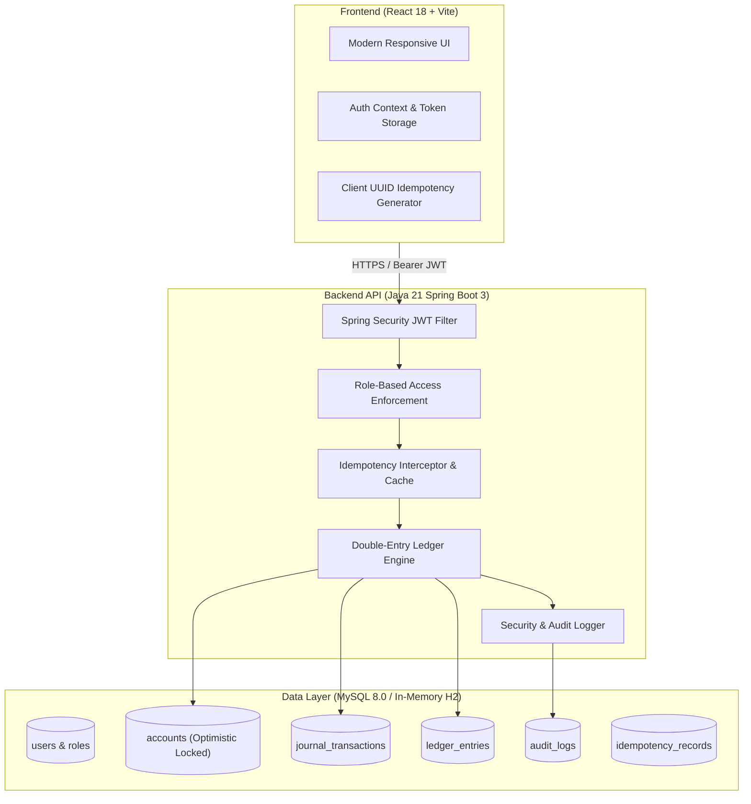
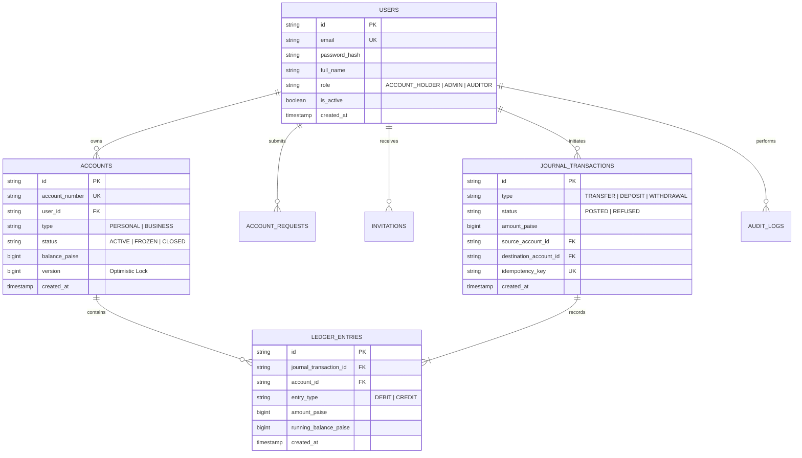

# BalanceVault — Money Movement with a Ledger You Can Prove

> **A secure financial account management platform featuring server-enforced role-based access control, onboarding workflows, auditable double-entry ledger operations, and idempotent transaction processing.**

Developed for the **Snovasys Fresher Hiring Challenge 2026**.

---

## 1. System Architecture

BalanceVault decouples front-of-house financial interactions from the back-of-house double-entry accounting ledger.



---

## 2. Database Entity Relationship Diagram



---

## 3. Core Financial & Security Guarantees

### A. Mathematical Balance Invariant
All balances are handled exclusively as integer **Paise** (`Long`, 1 Rupee = 100 Paise), completely avoiding floating-point precision loss. For every transfer:

$$\Delta \text{Balance}_{\text{Source}} = -\text{amountPaise}$$
$$\Delta \text{Balance}_{\text{Destination}} = +\text{amountPaise}$$
$$\sum \text{Debits} + \sum \text{Credits} = 0$$

### B. Exactly-Once Idempotency Protection
Network retries can lead to double-debiting. Every transfer, deposit, and withdrawal endpoint enforces an `Idempotency-Key` header with client UUID generation. Retrying the same key returns the exact cached receipt without altering balances. Altering the payload with a reused key triggers `HTTP 409 Conflict`.

### C. Optimistic Concurrency Control
Accounts enforce optimistic locking via `@Version Long version`. Simultaneous debit requests across multiple threads are serialized at the database level, preventing race condition overdrafts.

### D. Server-Enforced RBAC
* **`ACCOUNT_HOLDER`**: Submit account opening requests, perform transfers/deposits/withdrawals, review personal statements.
* **`ADMIN`**: Review and approve onboarding queue, assign account numbers, invite admins/auditors, view system-wide audit logs.
* **`AUDITOR`**: Read-only oversight across all accounts, ledger statements, and security logs.

---

## 4. How to Run Locally

### Prerequisites
* Java JDK 21
* Node.js 18+ (for frontend)
* Docker & Docker Compose (optional, for MySQL)

---

### Option A: Complete Stack via Docker Compose (Recommended)

1. Start MySQL 8.0 and the Spring Boot backend:
   ```bash
   docker compose up --build -d
   ```
2. Start the React frontend:
   ```bash
   cd frontend
   npm install
   npm run dev
   ```
3. Open your browser at **`http://localhost:5173`**.

---

### Option B: Standalone Spring Boot Backend

The backend includes a zero-setup in-memory H2 profile if you don't have MySQL running locally:

```bash
cd backend
./mvnw clean spring-boot:run -Dspring-boot.run.profiles=dev
```

To run against a local MySQL instance:
```bash
./mvnw clean spring-boot:run -Dspring-boot.run.profiles=mysql
```

---

## 5. Default Administrator Credentials (Bootstrap)

The first administrator is automatically bootstrapped on initial application boot:

| Field | Value |
| :--- | :--- |
| **Email** | `admin@balancevault.com` |
| **Password** | `Admin@Vault2026!` |
| **Role** | `ADMIN` |

---

## 6. Running Automated Tests

Run the full suite of unit and integration tests (verifying double-entry ledger balance, insufficient funds refusal, and idempotency guarantees):

```bash
cd backend
./mvnw test
```

---

## 7. API Reference Summary

| Method | Endpoint | Authorization | Description |
| :--- | :--- | :--- | :--- |
| `GET` | `/api/ready` | Public | System health & engine readiness |
| `POST` | `/api/auth/register` | Public | Register new account holder |
| `POST` | `/api/auth/login` | Public | Authenticate & get JWT |
| `POST` | `/api/auth/accept-invitation` | Public | Complete invited admin/auditor onboarding |
| `GET` | `/api/accounts` | Authenticated | List authorized accounts |
| `GET` | `/api/accounts/{id}/statement` | Authenticated | Fetch cursor-paginated ledger entries |
| `POST` | `/api/transfers` | `ACCOUNT_HOLDER` | Transfer funds (requires `Idempotency-Key`) |
| `POST` | `/api/deposits` | `ACCOUNT_HOLDER` | Deposit funds |
| `POST` | `/api/withdrawals` | `ACCOUNT_HOLDER` | Withdraw funds |
| `GET` | `/api/account-requests/admin/queue` | `ADMIN` | Pending onboarding verification queue |
| `POST` | `/api/account-requests/admin/{id}/approve` | `ADMIN` | Approve request & assign account number |
| `GET` | `/api/audit` | `ADMIN`, `AUDITOR` | Paginated system audit log |

---

## 8. Deployment Guidelines

* **Backend:** Deploy on **Railway** or **Render** using the provided `backend/Dockerfile` and configure MySQL database connection variables (`DB_HOST`, `DB_USER`, `DB_PASSWORD`, `DB_NAME`).
* **Frontend:** Deploy on **Vercel** or **Netlify** with environment variable `VITE_API_URL=https://<your-backend-domain>`.
